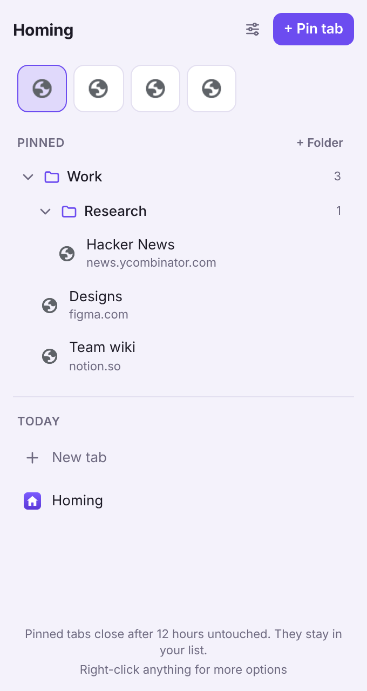

# Homing

**Tabs that find their way home.** A sidebar for Chrome with a Favorites icon grid, pinned tabs in folders that remember their *home* page, and your open tabs, all in Chrome's side panel.

Inspired by the Arc browser. Arc is winding down, and these are the features I missed most, so I rebuilt them for Chrome.



## Features

**Pinned tabs that remember home**
- Pin a tab and Homing remembers the page it started on.
- When a pinned tab wanders off, the panel shows where it is now ("Away: …"). One click on ↺ (or `Alt+Shift+H`) takes it back home.
- Found a better starting page? Hit ⌂ to make it the new home.
- Rename pinned tabs to swap long titles like "Inbox (23) – …" for your own names.

**Organise**
- **Favorites:** your most-used sites as big icons at the top. An orange dot means the tab has wandered from home.
- **Folders and subfolders:** collapsible, renameable, nested as deep as you like.
- **Today:** the window's other open tabs, listed below your pins.
- **Drag and drop everywhere:** drag a tab into Favorites or a folder to pin it, or drag a pin down to Today to unpin it.

**Stays out of your way**
- **Auto-close:** pinned tabs you haven't touched for 12 hours (configurable) close on their own. They stay in their folder, and one click reopens them at home.
- Pins survive closing their tab and restarting Chrome.
- Everything is stored locally in your browser. No accounts, no servers, no tracking.

## Install (developer mode)

1. Clone or download this repo.
2. Open `chrome://extensions` and turn on **Developer mode** (top right).
3. Click **Load unpacked** and select the project folder.
4. Pin the Homing icon to your toolbar and click it to open the side panel.

Requires Chrome 121 or later.

**Tip:** to put the side panel on the right or left, go to Chrome **Settings → Appearance → Side panel**.

## Usage

| Action | How |
| --- | --- |
| Pin the current tab | **+ Pin tab**, right-click a page → *Pin to Homing*, or `Alt+Shift+P` |
| Go to a pinned tab | Click it (reopens it at home if it was closed) |
| Back to home | ↺ on the tab, or `Alt+Shift+H` |
| Make the current page home | ⌂ (shown on hover when a tab has wandered off) |
| Rename a pinned tab | Double-click it, hover → pencil, right-click → *Rename*, or `F2`. Clear the name to go back to the page title |
| Add to Favorites | Drag a tab into the grid, or right-click → *Add to Favorites* |
| Create a folder / subfolder | **+ Folder**, or hover a folder → folder-plus icon |
| Add a tab to a folder | Drag it onto the folder, or right-click it in Today → *Add to folder* |
| Nest or move folders | Drag a folder onto another (middle = inside, top/bottom edge = next to it) |
| Unpin | × on hover, right-click → *Unpin*, or drag down to Today |
| Change auto-close time | Settings icon (top right): Never, 1 hour … 1 week |
| Everything else | Right-click |

You can change the shortcuts at `chrome://extensions/shortcuts`.

## How it works

```
manifest.json         Manifest V3 config
src/pins.js           Pins, favorites, folders and settings: state + operations
src/background.js     Service worker: tab events, shortcuts, context menu, auto-close alarm
sidepanel/            The side panel UI (plain HTML/CSS/JS, no build step)
```

- **One writer:** the side panel never changes data itself. It sends a message, and the service worker runs every change one at a time through a small promise queue, so clicks and tab events can't overwrite each other. The panel re-renders when storage changes.
- **Tabs vs pins:** each pin stores the `tabId` it's linked to, or `null` when the tab is closed. Tab IDs change after a restart, so Homing re-links pins to the restored pinned tabs (exact URL first, then same site).
- **Auto-close** checks every 5 minutes using Chrome's `tab.lastAccessed`. It never closes the tab you're looking at or one that's playing audio.
- **Favicons** come from Chrome's built-in `_favicon` cache, so the panel makes no network requests.
- **Safe rendering:** page titles are inserted as text, never as HTML.

## Known limitations

- Chrome doesn't let extensions hide its own tab strip, so tabs still appear there too.
- Unpinning a tab from Chrome's tab strip doesn't unpin it in Homing.
- After a long break, pinned tabs Chrome restores on startup may count as "untouched" and auto-close soon after. They stay in your list.
- Pins are shared across all windows. Clicking one may switch you to the window it's open in.
- Folders always appear above loose pinned tabs.

## Roadmap

- [ ] Undo for unpin and delete
- [ ] Export / import (backup your pins and folders)
- [ ] Search across pins and open tabs
- [ ] Auto-archive for unpinned tabs, with a searchable archive
- [ ] Spaces (separate sets of pins for work and personal)
- [ ] Chrome Web Store release

Ideas and PRs are welcome. Open an issue first for bigger changes.

## About

Built by **Laiba Shahid** with AI-assisted development using [Claude](https://claude.ai). I decided what to build and how it should behave, and tested it in my own browser. Claude helped design and write the code, which I reviewed.

## License

[MIT](LICENSE) © 2026 Laiba Shahid

*Not affiliated with The Browser Company or Arc.*
